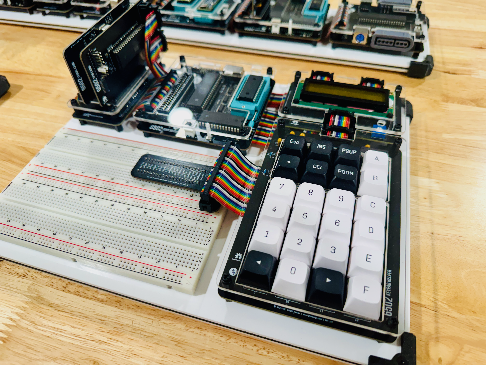

6502-KIM
========



*(Image shows the alternative Main Board configuration — preferred Backplane/Backplane Pro build pictured separately)*

An **AC6502** retro-style 8-bit computer based on the **65C02** microprocessor.

> 📖 **Guide:** [AC6502 Documentation](https://acwright.github.io/6502-DOCS/) — the user's and programmer's guide for the whole family.
> See [The KIM keypad add-on chapter](https://acwright.github.io/6502-DOCS/addons/kim).

---

## Table of Contents

- [Overview](#overview)
- [Architecture](#architecture)
- [Systems](#systems)
- [Software](#software)
- [Hardware](#hardware)
  - [KIM Board](#kim-board) *(in design)*
  - [Backplane / Backplane Pro](#backplane--backplane-pro) *(preferred)*
  - [CPU Card](#cpu-card) *(preferred)*
  - [Memory Card](#memory-card) *(preferred)*
  - [Serial Card](#serial-card)
  - [Backplane Helper](#backplane-helper)
  - [Keypad Card](#keypad-card)
  - [Keypad Helper](#keypad-helper)
  - [Keypad LCD Helper](#keypad-lcd-helper)
  - [Main Board](#main-board) *(alternative)*
- [Firmware](#firmware)
- [CAD](#cad)
- [Production](#production)
- [Schematics](#schematics)
- [Checking the schematics](#checking-the-schematics)
- [Libraries](#libraries)
- [Bill of Materials](#bill-of-materials)
  - [Keypad Card](#keypad-card-1)
  - [Keypad Helper](#keypad-helper-1)
  - [Keypad LCD Helper](#keypad-lcd-helper-1)
- [Purchase](#purchase)
- [License](#license)

## Overview

The AC6502 ecosystem is a family of open-source, 65C02-based computers sharing a common architecture, memory map, and [BIOS](https://github.com/acwright/6502-BIOS). Each computer in the family is purpose-built for a different use case but runs the same software and firmware.

The **KIM** (Keypad Input Monitor) is a complete, self-contained 65C02 computer. The preferred way to build it is using a **[Backplane or Backplane Pro](https://github.com/acwright/6502-COB)**, **[CPU Card](https://github.com/acwright/6502-COB)**, and **[Memory Card](https://github.com/acwright/6502-COB)** from the COB project, along with the **[Serial Card](https://github.com/acwright/6502-COB)** and **[Backplane Helper](https://github.com/acwright/6502-COB)** (also from COB) and the **Keypad Card** — a card that the **Keypad Helper** (keypad matrix) and **Keypad LCD Helper** (16x2 LCD display) attach to. As an alternative, the **[Main Board](https://github.com/acwright/6502-VCS)** from the VCS project can be substituted for the Backplane/CPU/Memory combination.

The **[KIM Board](#kim-board)** puts the whole KIM on one through-hole board, with two breadboards for building circuits beside the keypad. Its memory map and I/O addresses are the same as today's KIM, so the KC Monitor, the BIOS and every program run on it unchanged. Rev 1.0 is in design: the schematic is drawn and checked, and the PCB is being laid out.

## Architecture

All AC6502 computers share:

- **CPU**: 65C02 (or accurate emulation)
- **Memory**: 32KB RAM + 32KB ROM, with optional banked RAM expansion
- **Memory Map**: Standardized across the ecosystem — zero page, stack, I/O space ($8000–$9FFF), system ROM, and interrupt vectors at $FFFA–$FFFF
- **Bus**: 16-bit address bus, 8-bit bidirectional data bus, standard 65C02 control signals (RW, PHI2, RESET, IRQ, NMI, RDY, SYNC)
- **BIOS**: A common [BIOS](https://github.com/acwright/6502-BIOS) provides the kernel, monitor, and BASIC interpreter across all systems

## Systems

| Project | Description |
|---------|-------------|
| [6502-ACE](https://github.com/acwright/6502-ACE) | All-in-one Computer Experience — A single board computer |
| [6502-COB](https://github.com/acwright/6502-COB) | Computer On a Backplane — Modular desktop computer with expandable card slots |
| [6502-DEV](https://github.com/acwright/6502-DEV) | Development Environment Vehicle — Emulation-based dev system |
| [6502-KIM](https://github.com/acwright/6502-KIM) | Keypad Input Monitor - KIM-1 inspired minimal computer (YOU ARE HERE) |
| [6502-VCS](https://github.com/acwright/6502-VCS) | Video Computer System — Cartridge-based retro gaming console |

## Software

| Project | Description |
|---------|-------------|
| [6502-BIOS](https://github.com/acwright/6502-BIOS) | The shared BIOS (kernel, monitor, BASIC) for all AC6502 computers |
| [6502-EMULATOR](https://github.com/acwright/6502-EMULATOR) | Emulator for the whole family — desktop app, browser build, and a command line for scripted runs |
| [6502-PRG](https://github.com/acwright/6502-PRG) | Template project for writing assembly language programs |
| [6502-CRT](https://github.com/acwright/6502-CRT) | Template project for writing assembly language cartridges |
| [6502-ASM](https://github.com/acwright/6502-ASM) | Assembly language example programs and demos |
| [6502-BAS](https://github.com/acwright/6502-BAS) | BASIC program listings |
| [6502-WOZMON](https://github.com/acwright/6502-WOZMON) | Wozmon as a standalone ROM |
| [6502-NOP](https://github.com/acwright/6502-NOP) | An all-NOP ROM, for probing a board during bring-up |
| [6502-DOCS](https://github.com/acwright/6502-DOCS) | The documentation site — the guide, the printable reference cards, branding and label artwork |
| [cffs](https://github.com/acwright/cffs) | Builds CompactFlash disk images for the BIOS filesystem |
| [bastok](https://github.com/acwright/bastok) | Tokenizes BASIC listings into `.prg` images, and back |
| [bin2woz](https://github.com/acwright/bin2woz) | Converts a binary into a Wozmon serial upload |

## Hardware

This repository contains KiCad 7.0+ PCB designs for the KIM-specific hardware. The KIM Board is the whole KIM on one board. Today's KIM, described after it, also uses boards, cards, and helpers from the [6502-COB](https://github.com/acwright/6502-COB) project, and optionally from the [6502-VCS](https://github.com/acwright/6502-VCS) project.

### KIM Board
`Hardware/KIM Board/`

*Rev 1.0 is in design. The schematic is drawn and passes its checks (see [Checking the schematics](#checking-the-schematics)), the PCB is being laid out, and no boards have been made yet.*

One through-hole board that joins every part of today's KIM. The computer itself (CPU, RAM, ROM, glue logic and the I/O decode) is the ACE Board Rev 1.1's. The clock, the reset and the power input are the Backplane Pro Rev 1.1's. The serial port is the Serial Card's, and the keypad, the LCD and the KC Monitor are the Keypad Card's, Keypad Helper's and Keypad LCD Helper's. The card slot and the 6502 BUS header are the Backplane Helper's. The keypad, the LCD, the card slot and the 6502 BUS header sit exactly where they are on today's KIM, and the board fits today's base plate. Provides:

- **CPU**: 65C02 (U1) at 1 MHz, clocked by a 1 MHz DIP-14 oscillator (X1)
- **RAM**: 32KB SRAM (AS6C62256, U2)
- **ROM**: 32KB EEPROM (AT28C256, U3) holding the BIOS, on a footprint that takes a ZIF socket or an ordinary one
- **Keypad and display**: W65C21N PIA (U8), the KC Monitor's 8KB AT28C64 (U9) in a plain socket, the 24-key keypad with its MM74C922 encoder (U16), and the 16×2 LCD (U13) with its 10kΩ contrast trimmer (VR1). R19 beside VR1 is not fitted. It is there for a trimmer larger than 10kΩ: a resistor fitted in parallel brings the trimmer near 10kΩ.
- **Serial**: R6551AP ACIA (U15) at `$9000` with a MAX232 (U14) and a 1.8432 MHz crystal (Y1). The female DB-9 (J2) is wired as **DCE**, as on the Serial Card, so a straight-through cable reaches a PC. The `CTS EN` jumper (J3) picks whether the ACIA's `CTS` comes from ground or from the cable. **Ground is the default**, which leaves the transmitter always free to send
- **Reset**: 555 power-on reset (U12, Q1) and a reset button (SW26)
- **Power**: 5V DC, center positive, through a barrel jack (J7), a 1N5819 reverse-polarity diode (D5) and the power switch (SW27)
- **Expansion**: one card slot (J4), the 6502 BUS header (J5), and the breadboards with the breadboard headers (J6)

#### The KIM enable jumper (J1)

The jumper marked `KIM ENABLE` switches the KIM on or off:

- **Fitted**: the KIM. The machine starts in the KC Monitor, with the keypad and the LCD.
- **Open**: BASIC over the serial port, as today's KIM runs with its Keypad Card pulled. The keypad and the LCD do nothing.
- **Open before fitting a cartridge** in the card slot.

The jumper grounds `KIMB`, which enables the Keypad Card's first 74HC138 (U10, on its `~E1`). With the jumper open, R15 (10kΩ) holds `KIMB` high, so U10 is disabled and neither the PIA nor the KC Monitor's ROM is ever selected. A BAT85 (D1) joins `KIMB` to `HRDB`, anode on `HRDB`. When the jumper is fitted, it pulls `HRDB` low through D1, which takes `$C000–$FFFF` away from the BIOS ROM, as the Keypad Card does today. A cartridge pulling `HRDB` low can't pull `KIMB` low through D1, so only the jumper switches the KIM on.

Reads with `PHI2` high:

| KIM enable | Cartridge | `$0000–$7FFF` | `$8000–$9FFF` | `$A000–$BFFF` | `$C000–$DFFF` | `$E000–$FFFF` |
|---|---|---|---|---|---|---|
| fitted | out | RAM | IO1–IO8 | ROM | PIA | KC Monitor ROM |
| open | out | RAM | IO1–IO8 | ROM | ROM | ROM |
| open | in | RAM | IO1–IO8 | ROM | cartridge | cartridge |
| fitted | in | RAM | IO1–IO8 | ROM | **PIA and cartridge** | **KC Monitor ROM and cartridge** |

The last row is a mistake: the PIA and the KC Monitor's ROM fight the cartridge over the data bus. Open the jumper before fitting a cartridge.

With the jumper open, `RESB` still resets the PIA. That clears its control registers, so its interrupts stay off and it never pulls `IRQB`. The PIA's own pull-ups hold the LCD's `E` and `R/W` high and turn the keypad encoder's outputs off, so neither the LCD nor the encoder drives anything.

#### The IO ENABLE switch (SW25)

The eight-way DIP switch marked **IO ENABLE** has one position for each of the eight 1KB I/O windows, IO1 to IO8. U7, a 74HC138, decodes `$8000–$9FFF` into the eight windows, and switch *n* passes window *n*'s select through as `IOnB`. With a switch off, a 1kΩ pull-up holds that select high, so nothing in that window is selected.

| Switch | Select | Window | On the board |
|---|---|---|---|
| 1 | `IO1B` | `$8000–$83FF` | breadboard headers only |
| 2 | `IO2B` | `$8400–$87FF` | breadboard headers only |
| 3 | `IO3B` | `$8800–$8BFF` | breadboard headers only |
| 4 | `IO4B` | `$8C00–$8FFF` | breadboard headers only |
| 5 | `IO5B` | `$9000–$93FF` | the serial port's ACIA (U15), and the breadboard headers |
| 6 | `IO6B` | `$9400–$97FF` | breadboard headers only. **IO6** is the window for breadboard circuits |
| 7 | `IO7B` | `$9800–$9BFF` | breadboard headers only |
| 8 | `IO8B` | `$9C00–$9FFF` | breadboard headers only |

Leave switch 5 on: it is the serial port. The others matter only to a breadboard circuit that uses its select. A card in the card slot decodes its own address and doesn't use these switches.

#### The card slot (J4) and the 6502 BUS header (J5)

The card slot takes one COB card or one ACE or VCS cartridge. The 6502 BUS header is a 2×20 box header that takes a ribbon cable to a COB Backplane, which is how the KIM Board grows into a bigger machine. Both carry the same bus as the breadboard headers. `EXP0` and `EXP1` are both `HRDB`, as on the ACE. `EXP2` and `EXP3` are bus lines with nothing on the board attached.

- **A COB card** in the card slot decodes its own address. It must not use IO5, the serial port, or a window a breadboard circuit uses.
- **An ACE or VCS cartridge** in the card slot gets `$C000–$FFFF` while the KIM enable jumper is open (the third row of the table above).
- **A COB Backplane** on the 6502 BUS header adds no pull-ups of its own. The KIM Board carries the one 10kΩ pull-up on each shared line (`IRQB`, `NMIB`, `RESB`, `RDY`, `BE`).

#### The breadboards

The bottom-left of the board holds two snap-together breadboards, each 6.5 × 2.25 in, as on today's KIM. The breadboards are where circuits are built: the **breadboard circuits**, the LED latch at `$9400` first. Nothing is mounted under them.

The **breadboard headers** (J6) bring the whole bus and the eight I/O selects to the breadboards. They are one straight strip of female headers just above the breadboards, which jumper wires plug into: a 1×20, a 1×20 and a 1×10, left to right, with one empty pitch between them.

| Header | Pins, left to right |
|---|---|
| Row 1 (the bus's odd pins) | GND, `RESB`, `IRQB`, `NMIB`, `RDY`, `BE`, `RWB`, `SYNC`, `PHI2`, `EXP3`, `EXP2`, `D7`, `D6`, `D5`, `D4`, `D3`, `D2`, `D1`, `D0`, VCC |
| Row 2 (the bus's even pins) | VCC, `EXP1` (`HRDB`), `EXP0` (`HRDB`), `A15`, `A14`, `A13`, `A12`, `A11`, `A10`, `A9`, `A8`, `A7`, `A6`, `A5`, `A4`, `A3`, `A2`, `A1`, `A0`, GND |
| Select | GND, `IO1B`, `IO2B`, `IO3B`, `IO4B`, `IO5B`, `IO6B`, `IO7B`, `IO8B`, VCC |

- **The bus keeps its pin numbers.** Row 1 is the 6502 BUS header's odd pins in order, and Row 2 its even pins, so one pin table describes the 6502 BUS header, the card slot and the breadboard headers.
- **Each header has power at both ends**, so a breadboard circuit finds GND and VCC next to the signals it uses.
- **The selects come after the IO ENABLE switch.** A select reaches the breadboard headers only while its switch is on.

**Rules for breadboard circuits:**

- A circuit drives `D0`–`D7` only while it is selected, `PHI2` is high and `RWB` is high.
- A circuit may pull `IRQB`, `NMIB` and `RESB` low, open-drain, and must never drive them high.
- `IO1B`–`IO8B` are address decodes only, not qualified by `PHI2` or `RWB`, exactly as on the ACE. A circuit qualifies its writes with `PHI2`, as the LED latch does.
- `IO5B` is the board's own serial port. Build in **IO6** (`$9400–$97FF`), the window the series uses for its breadboard circuits.
- At boot, the Kernal probes for the cards it knows, and the probe reads and writes their windows. A circuit in a window other than IO6 should expect to be read and written at boot.
- A circuit that pulls `HRDB` (`EXP0`/`EXP1`) low takes `$C000–$FFFF` from the ROM, as a cartridge does. D1 keeps it from switching the KIM on.

The LED latch's schematic is the one-page KIM Demo sheet in [6502-DOCS](https://github.com/acwright/6502-DOCS). It decodes `$9400` with its own 74HC138 from `A10`–`A15`, so it doesn't need `IO6B`. `IO6B` on the breadboard headers offers the same select ready-made, for later circuits.

### Backplane / Backplane Pro
[`Hardware/Backplane/`](https://github.com/acwright/6502-COB/tree/main/Hardware/Backplane) *(6502-COB — preferred)*

Passive backplane providing 5 card slots with full bus interconnect across all slots. The **Backplane Pro** is an enhanced variant with integrated clock generation, reset circuitry, and power distribution.

### CPU Card
[`Hardware/CPU Card/`](https://github.com/acwright/6502-COB/tree/main/Hardware/CPU%20Card) *(6502-COB — preferred)*

Hosts the 65C02 CPU in a card form factor. Plugs into the Backplane or Backplane Pro.

### Memory Card
[`Hardware/Memory Card/`](https://github.com/acwright/6502-COB/tree/main/Hardware/Memory%20Card) *(6502-COB — preferred)*

Provides 32KB SRAM and 32KB EEPROM with address decoding logic. Plugs into the Backplane or Backplane Pro.

### Serial Card
[`Hardware/Serial Card/`](https://github.com/acwright/6502-COB/tree/main/Hardware/Serial%20Card) *(6502-COB)*

RS-232 serial communication via 65C51 ACIA and MAX232 level shifter. Optional — usually fitted, and required for the KC Monitor's serial monitor, but the KIM runs keypad-only without it.

### Backplane Helper
[`Hardware/Backplane Helper/`](https://github.com/acwright/6502-COB/tree/main/Hardware/Backplane%20Helper) *(6502-COB)*

Adds additional card slots to expand the total backplane configuration.

### Main Board
[`Hardware/Main Board/`](https://github.com/acwright/6502-VCS/tree/main/Hardware/Main%20Board) *(6502-VCS — alternative)*

An all-in-one board containing the 65C02 CPU, 32KB SRAM, 32KB EEPROM, clock, and reset circuitry. Can be used in place of the Backplane + CPU Card + Memory Card combination.

### Keypad Card
`Hardware/Keypad Card/`

The card that makes the KIM a KIM. A cartridge card carrying its own ROM and I/O, which the Keypad Helper and Keypad LCD Helper attach to. Provides:

- **PIA**: 65C21 — Port A carries the keypad code (PA0–PA4) and the LCD control lines (PA5 = RS, PA6 = R/W, PA7 = E); Port B is the LCD data bus. CA1 is the keypad data-available interrupt, CA2 the keypad encoder's output enable.
- **ROM**: AT28C64 8KB EEPROM holding the cartridge firmware — see [Firmware](#firmware)
- **Decoding**: two 74HC138 decoders
- **Ports**: PORT A and PORT B headers for the Keypad Helper and the Keypad LCD Helper

Unlike every other card in the family, the Keypad Card **overlays the top of the address space**. Its ROM replaces BASIC, the Monitor, Wozmon and the CPU vectors, while `$A000–$BFFF` stays reachable and is called into by the cartridge:

| Range | Contents |
|-------|----------|
| `$A000–$B7FF` | BIOS Kernal (unchanged, still callable) |
| `$B800–$BFFF` | CP437 character set (unchanged, still readable) |
| `$C000–$DFFF` | PIA registers (mirrored I/O window) |
| `$E000–$FFF9` | Cartridge ROM (AT28C64, 8KB) |
| `$FFFA–$FFFF` | CPU vectors (NMI, RESET, IRQ) — the cartridge's own |

This takeover is the reason the KIM behaves differently from every other system in the family, and it is why the KIM is not currently emulated by the [emulator](https://github.com/acwright/6502-EMULATOR) or the [DEV board](https://github.com/acwright/6502-DEV).

### Keypad Helper
`Hardware/Keypad Helper/`

The keypad itself, attaching to the Keypad Card — either directly to PORT A, or through the pass-through header on the Keypad LCD Helper. Provides:

- **Input**: 24 Cherry MX key switches wired as a 4×6 matrix
- **Encoder**: MM74C922 16-key encoder, extended to 24 keys with a 74HC00
- **Output**: 5-bit keycode plus a data-available strobe over a 2×6 PORT header

Scanning, debounce and encoding are all done in hardware. The helper carries no microcontroller and runs no firmware of its own.

### Keypad LCD Helper
`Hardware/Keypad LCD Helper/`

Display companion board that sits between the Keypad Card and the Keypad Helper. Provides:

- **Display**: 16×2 HD44780 LCD with a 10kΩ contrast trimmer, driven from PORT A (RS, R/W, E) and PORT B (8-bit data bus)
- **Pass-through**: a KEYPAD header carrying PA0–PA4, CA1 and CA2 straight through to the Keypad Helper

Like the Keypad Helper, this board carries no microcontroller and runs no firmware — the LCD is driven directly by the Keypad Card's PIA.

## Firmware

`Firmware/KC Monitor/`

The **KC Monitor** is a 6502 assembly language cartridge ROM for the KIM system. It burns to the Keypad Card's AT28C64 and turns the card into a KIM-1-style hex monitor: browse and edit memory and execute code from the 24-key keypad and 16×2 LCD, with a concurrent Wozmon-compatible serial monitor over the Serial Card when one is fitted. See [`Firmware/KC Monitor/README.md`](./Firmware/KC%20Monitor/README.md).

It is the only firmware in this repository — the Keypad Helper and Keypad LCD Helper are hardware-only boards and run no code.

## CAD
`CAD/`

3D-printable enclosure bases and laser-cut top panels for the KIM system.

## Production
`Production/`

JLCPCB-ready Gerber files and BOM/CPL for PCB fabrication and assembly.

## Schematics
`Schematics/`

PDF schematics for all KIM hardware.

## Checking the schematics
`Tests/check-schematics.mjs`

This script checks the KIM Board's logic by evaluating its netlist, not by reading the gates. It is built on the ACE's checker, written after the ACE's banked RAM latches were wrong twice and both times looked right on paper. It asks KiCad for the KIM Board's netlist, builds the glue logic from the gates it finds there, and drives every address, as a read and as a write, with `PHI2` high and low, the KIM enable jumper fitted and open, a cartridge in the card slot and out, and the IO ENABLE switches all on and then each one off. That is 9,437,184 bus states. A net that nothing drives counts as a failure, so a missing wire fails too.

It checks:

- the memory map in the KIM enable jumper's table, with the jumper fitted and open;
- that at most one chip drives the data bus on any read, except with the jumper fitted and a cartridge in;
- that the PIA and the KC Monitor's ROM are never selected with the jumper open, and that a cartridge pulling `HRDB` low never pulls `KIMB` low;
- that the ACIA is selected only at `$9000–$93FF`, and only with IO ENABLE switch 5 on;
- that each select on the breadboard headers is low only in its own 1KB window;
- that the CPU, the PIA and the ACIA run from the 1 MHz oscillator;
- one 10kΩ pull-up on each shared line, `SOB` tied to VCC, and `RESB` pulled low only by the reset transistor.

Run it after any change to the KIM Board's schematic:

```sh
node Tests/check-schematics.mjs
```

It needs Node.js and KiCad's `kicad-cli`, which it finds on the `PATH`, at the macOS default location, or through a `KICAD_CLI` environment variable. It takes about 30 seconds, prints `ok` or `FAIL` for each check, and exits non-zero on a failure. It takes another schematic's path as an argument, for checking a modified copy.

## Libraries
`Libraries/`

Shared KiCad symbol and footprint libraries used across all AC6502 hardware projects.

## Bill of Materials

### Keypad Card

| Reference | Qty | Value | Description | LCSC | DigiKey | Mouser | Other |
|-----------|-----|-------|-------------|------|---------|--------|-------|
| C1–C4 | 4 | 100nF | SMD Capacitor 0805 | [C49678](https://www.lcsc.com/search?q=C49678) | | | |
| J2, J3 | 2 | PORT A/B | Box Header 2×6 2.54mm | | [2057-BHR-12-VUA-ND](https://www.digikey.com/en/products/filter?keywords=2057-BHR-12-VUA-ND) | | |
| U1, U2 | 2 | 74HC138 | 3-to-8 Line Decoder | [C5602](https://www.lcsc.com/search?q=C5602) | | | |
| U3 | 1 | 65C21 | Peripheral Interface Adapter | | | [955-W65C21N6TPG-14](https://www.mouser.com/ProductDetail/955-W65C21N6TPG-14) | |
| U4 | 1 | AT28C64 | 8K×8 EEPROM | | [AT28C64B-15PU-ND](https://www.digikey.com/en/products/filter?keywords=AT28C64B-15PU-ND) | [556-AT28C64B15PU](https://www.mouser.com/ProductDetail/556-AT28C64B15PU) | |

### Keypad Helper

| Reference | Qty | Value | Description | DigiKey | Mouser | Other |
|-----------|-----|-------|-------------|---------|--------|-------|
| C1, C2, C4 | 3 | 100nF | Disc Capacitor | [478-5732-ND](https://www.digikey.com/en/products/filter?keywords=478-5732-ND) | | [AMAZON](https://www.amazon.com/PANMILED-Multilayer-Monolithic-Capacitors-Assortment/dp/B0CYQ1Z4G5) |
| C3 | 1 | 1µF | Disc Capacitor | [478-7667-ND](https://www.digikey.com/en/products/filter?keywords=478-7667-ND) | | [AMAZON](https://www.amazon.com/PANMILED-Multilayer-Monolithic-Capacitors-Assortment/dp/B0CYQ1Z4G5) |
| D1, D2 | 2 | 1N914 | Small Signal Diode | [1N914FS-ND](https://www.digikey.com/en/products/filter?keywords=1N914FS-ND) | | |
| J1 | 1 | PORT | Box Header 2×6 2.54mm | [2057-BHR-12-VUA-ND](https://www.digikey.com/en/products/filter?keywords=2057-BHR-12-VUA-ND) | | [AMAZON](https://www.amazon.com/uxcell-2-54mm-2x6-Pin-Straight-Connector/dp/B07DJYVZV2) |
| R1, R2 | 2 | 100kΩ | Resistor | | | [AMAZON](https://www.amazon.com/ALLECIN-8W-Metal-Film-Resistor/dp/B0C77TM3NR) |
| SW1–SW24 | 24 | 0–23 | Cherry MX Switch 1.00u | [CH196-ND](https://www.digikey.com/en/products/filter?keywords=CH196-ND) | | [AMAZON](https://www.amazon.com/dp/B0FYR5TV3X) |
| U1 | 1 | MM74C922 | 16-Key Encoder | | | [AMAZON](https://www.amazon.com/Todiys-74C922N-MM74C922N-Encoder-MM74C922/dp/B08MCJY9LP) |
| U2 | 1 | 74HC00 | Quad 2-Input NAND Gate | [296-1563-5-ND](https://www.digikey.com/en/products/filter?keywords=296-1563-5-ND) | [595-SN74HC00N](https://www.mouser.com/ProductDetail/595-SN74HC00N) | |

### Keypad LCD Helper

| Reference | Qty | Value | Description | DigiKey | Mouser | Other |
|-----------|-----|-------|-------------|---------|--------|-------|
| J1, J2, J3 | 3 | PORT A/B/KEYPAD | Box Header 2×6 2.54mm | [2057-BHR-12-VUA-ND](https://www.digikey.com/en/products/filter?keywords=2057-BHR-12-VUA-ND) | | [AMAZON](https://www.amazon.com/uxcell-2-54mm-2x6-Pin-Straight-Connector/dp/B07DJYVZV2) |
| R1 | 1 | R | Resistor | | | |
| U2 | 1 | LCD-16X2 | 16×2 LCD Display | | | [AMAZON](https://www.amazon.com/MECCANIXITY-Display-Backlight-Interface-Adapter/dp/B0DSFXK7QK) |
| VR1 | 1 | 10kΩ | Potentiometer | [3386F-103LF-ND](https://www.digikey.com/en/products/filter?keywords=3386F-103LF-ND) | | |

## Purchase

I have a few PCBs available on Tindie for those interested in building their own AC6502 system without ordering from a fab directly.

<a href="https://www.tindie.com/stores/acwrightdesign/?ref=offsite_badges&utm_source=sellers_acwrightdesign&utm_medium=badges&utm_campaign=badge_medium"></a>

## License

Hardware designs are released under the [CERN Open Hardware Licence Version 2 – Permissive](https://ohwr.org/cern_ohl_p_v2.txt).  
Firmware is released under the [MIT License](./Firmware/KC%20Monitor/LICENSE).
